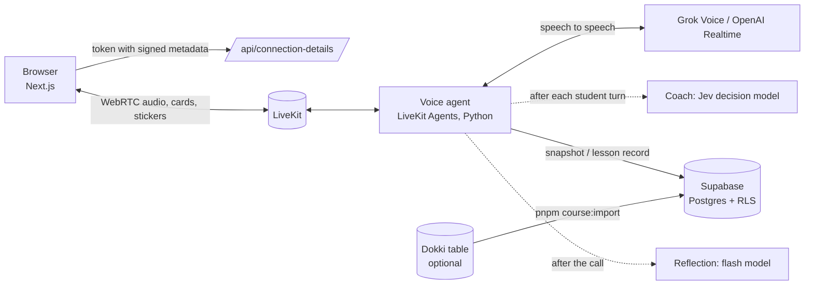

<div align="center">


# Speakwow

**An open-source AI voice teacher who remembers you.**

Talk to a teacher with a personality and a life of their own. They hear how you sound,
remember what you told them last week, teach your school textbook unit by unit,
and slide a card or a sticker across the screen when it helps.

[中文说明](README.zh-CN.md) · [Roadmap](docs/ROADMAP.md) · [Contributing](CONTRIBUTING.md)

[](https://github.com/Noxr3/Speakwow/actions/workflows/web.yml)
[](https://github.com/Noxr3/Speakwow/actions/workflows/agent.yml)
[](https://github.com/Noxr3/Speakwow/actions/workflows/supabase.yml)
[](LICENSE)

</div>

---

## Why

Language apps quiz you. A good teacher *knows* you: what you are working on, what
you said about your exam, when you are tired, when to push and when to laugh.
Speakwow is an attempt to build that teacher, in the open, for everyone who is
learning for life.

## What it does

| | |
|---|---|
| 🎙️ **Real-time voice** | Speech-to-speech, so the teacher hears hesitation and excitement and answers with feeling. Defaults to Grok Voice (`grok-voice-3.0`, pinned), with OpenAI Realtime one setting away. Turn-taking is tuned for learners who pause to find a word. |
| 🧠 **Remembers you** | After every call the lesson is reflected on: a summary, what you are working on, things a teacher would remember (your goals, your cat's name), and an estimated CEFR level. Next time, the teacher picks up where you left off. |
| 🧑‍🏫 **A teacher, not a chatbot** | Recasts mistakes instead of lecturing, stretches you when it is easy, scaffolds when you are stuck, and praises specifically. A fast background "coach" model notices when you are stuck or bored and quietly tells the teacher, without adding any delay. |
| 🏡 **Ten teachers, each with a life** | Frank, Lucy, Lily, Leo, Kai, Grace, Diego, Priya, Nora and Max: different accents, teaching styles and specialities (beginners, interviews, stories, science, songs…). Each has a backstory and storylines that move forward every few days, so small talk is two-way and consistent. Pick one on a 3D ring of animated cards and hear their voice. |
| 📚 **Your textbook, unit by unit** | Courses are data: units with goals, vocabulary, grammar and speaking tasks. In lesson mode the teacher works on your weakest goals, scores them after the call, and moves you on when a unit is mastered. Ships with the Jiangsu Yilin junior-high English course. |
| 🃏 **Cards and stickers mid-call** | The teacher can put a word card, quick quiz, fill-the-gap, sentence builder or "say it out loud" card on screen, and react with animated stickers. Your taps and stickers go straight back to the teacher. |
| 🗂️ **Your learning record** | One page with your course map, every unit's mastery, recent lessons, and everything the teacher remembers, each item erasable. |
| 🔑 **Bring your own key** | Use your own xAI or OpenAI key. It is encrypted (AES-256-GCM) before it is stored or handed to the voice service, and never appears in clear text in the database, LiveKit or logs. |
| 🧩 **Built to be forked** | A new teacher is one JSON file. A new course is one JSON file, or a table in [Dokki](https://dokki.one) your teachers edit together. Supabase is optional for a first run. |

## How it works



- `apps/web` — Next.js 15: the call UI, login, learning record, settings (BYOK).
- `apps/agent` — the teacher: persona + shared teacher layer + memory + lessons + tools.
- `packages/shared` — persona cards and the sticker set, read by both apps.
- `supabase/migrations` — schema with row-level security on every table; `supabase/tests` runs in CI.

## Quick start

You need Node 22, pnpm 9, Python 3.10+ with [uv](https://docs.astral.sh/uv/), a
[LiveKit](https://livekit.io) project (the free cloud tier, or
`livekit-server --dev` locally), and an xAI or OpenAI API key.

```bash
git clone https://github.com/Noxr3/Speakwow && cd Speakwow
pnpm install

# the teacher
cd apps/agent && cp .env.example .env.local   # LIVEKIT_* and XAI_API_KEY
uv sync && uv run src/agent.py download-files && uv run src/agent.py dev

# the web app (another terminal)
cd apps/web && cp .env.example .env.local     # LIVEKIT_*
pnpm dev                                      # http://localhost:3000
```

That is enough to talk as a guest. To turn on accounts, memory and courses, add
Supabase:

```bash
supabase start && supabase db reset           # local Postgres with the schema
pnpm course:import packages/shared/courses/yilin-2024-7a.json
```

then set `NEXT_PUBLIC_SUPABASE_URL` / `NEXT_PUBLIC_SUPABASE_ANON_KEY` for the web
and `SUPABASE_URL` / `SUPABASE_SERVICE_ROLE_KEY` for the agent.

## Configuration

| Variable | Where | What it does |
|---|---|---|
| `LIVEKIT_URL`, `LIVEKIT_API_KEY`, `LIVEKIT_API_SECRET` | web, agent | Your LiveKit project |
| `XAI_API_KEY` / `OPENAI_API_KEY` | agent | The operator's voice-model key (not needed if every user brings their own) |
| `REALTIME_PROVIDER` | agent | `xai` (default) or `openai` |
| `XAI_REALTIME_MODEL` / `OPENAI_REALTIME_MODEL` | agent | Default `grok-voice-3.0` (pinned, so a teacher's voice never changes overnight) / `gpt-realtime-2.1` |
| `TURN_SILENCE_MS` | agent | Silence that ends a student's turn on xAI (default 1100 ms for beginners and school students, 750 ms for B1+ adults) |
| `AI_GATEWAY_API_KEY` | agent | Turns on the coaching sidecar (Jev) and flash-model reflection via the Vercel AI Gateway |
| `MEMORY_LLM_API_KEY`, `MEMORY_LLM_BASE_URL`, `MEMORY_LLM_MODEL` | agent | Any OpenAI-compatible model for post-call reflection (e.g. a local Ollama) |
| `COACH=off` | agent | Turns the coaching sidecar off |
| `NEXT_PUBLIC_SUPABASE_URL`, `NEXT_PUBLIC_SUPABASE_ANON_KEY` | web | Accounts, learning record, courses |
| `SUPABASE_URL`, `SUPABASE_SERVICE_ROLE_KEY` | agent | Reading and writing memory (server-side only) |
| `BYOK_ENCRYPTION_KEY` | web, agent | 32 random bytes, base64 (`openssl rand -base64 32`). Enables bring-your-own-key |
| `REQUIRE_BYOK=true` | web | Every call must bring its own key (public demos that should not spend your credits) |
| `ALLOW_GUESTS=false` | web | Only signed-in students can start a call |
| `DOKKI_API_KEY`, `DOKKI_BASE_URL` | scripts | `pnpm course:import <file> --from-dokki <tableId>` |
| `XAI_API_KEY` / `OPENAI_API_KEY` | scripts | `pnpm voices:generate` writes each teacher's voice sample to `apps/web/public/voices/` |

## Design choices

- **Portable by default.** Every dependency is open source or swappable: Postgres
  (Supabase is self-hostable), LiveKit (self-hostable), any OpenAI-compatible model
  for reflection. We deliberately did not build on one cloud's proprietary
  database or realtime service, so you can run Speakwow anywhere, including fully
  on your own machines.
- **Speech-to-speech for the conversation, small fast models around it.** The voice
  model must answer within a second, so it is never asked to stop and think about
  pedagogy. A decision model (probabilities only, no text) judges each turn in the
  background, and a flash model writes the memory after the call.
- **Safety lives in one layer.** Red lines (learners may be children, no personal
  data, no medical or legal advice, honest about being an AI) sit in the shared
  teacher layer, and personas cannot override them. Text from students and course
  files is quoted as data, never as instructions.
- **Students own their memory.** Everything the teacher remembers is visible on the
  learning record and can be erased.

## Contributing

The easiest ways in:

- **Add a teacher** — one JSON file in `packages/shared/personas/` (personality,
  voices, openings, a life with storylines, two colours and a voiceprint motif for
  the card, a one-line voice sample). See [CONTRIBUTING.md](CONTRIBUTING.md).
- **Add a course** — one JSON file in `packages/shared/courses/`, or a Dokki table.
  Curriculum outlines only; never copy textbook passages.
- **Add a card type** — `apps/agent/src/widgets.py` + `apps/web/components/app/widget-card.tsx`;
  try it on `/playground` without a call.

Good first issues are labelled [`good first issue`](https://github.com/Noxr3/Speakwow/labels/good%20first%20issue).

## License

[MIT](LICENSE), with two exceptions noted in the files themselves:

- The animated components in `apps/web/components/` taken from [React Bits](https://reactbits.dev)
  (`ColorBends`, `GlassSurface`, `DotGrid`, `Magnet`, `Plasma`,
  `LiquidEther`) are © David Haz under MIT + Commons Clause: use them as part of an
  app, but do not sell or redistribute the components on their own.
- Animated stickers are [Noto Animated Emoji](https://googlefonts.github.io/noto-emoji-animation/)
  by Google, CC BY 4.0.

The web and agent apps started from LiveKit's MIT-licensed starter templates.
