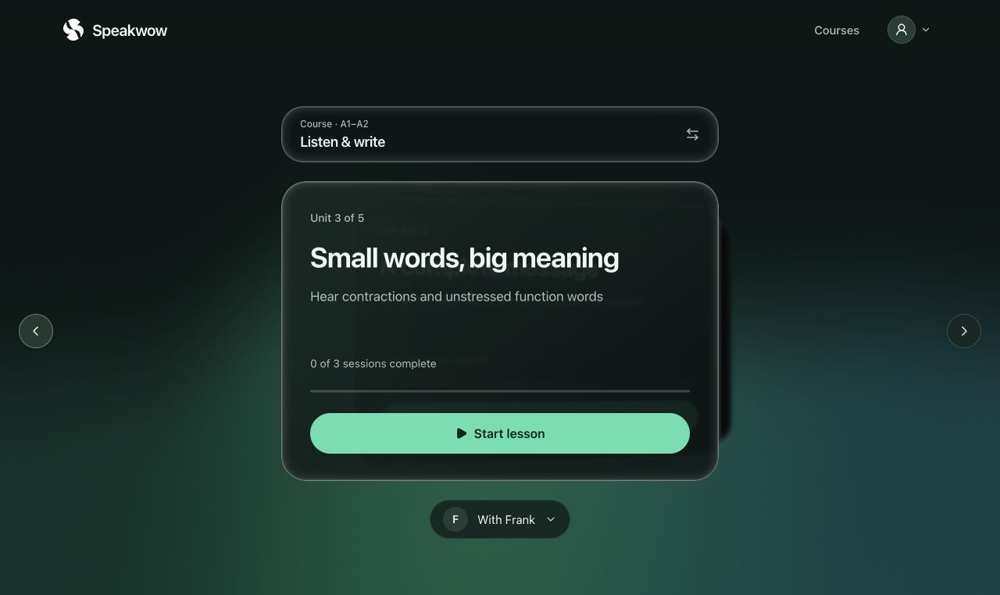
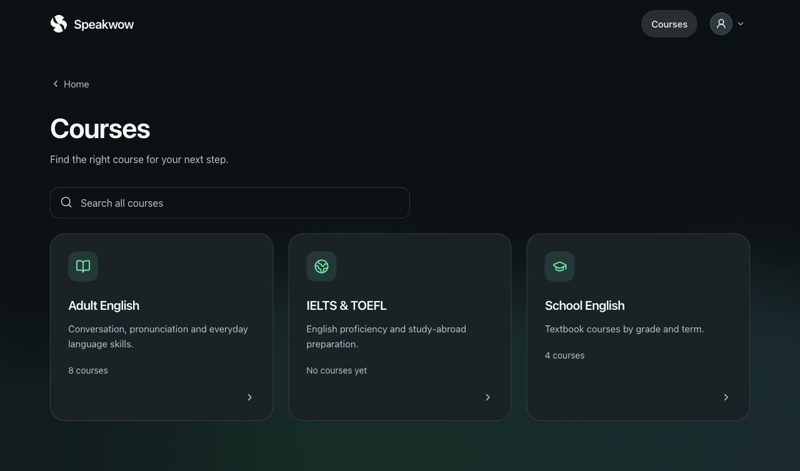
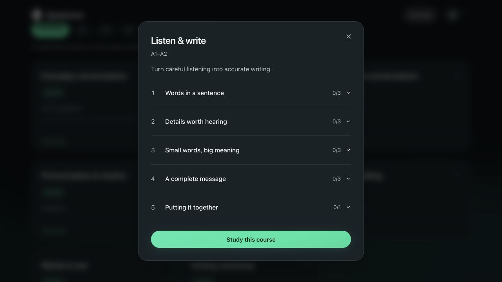
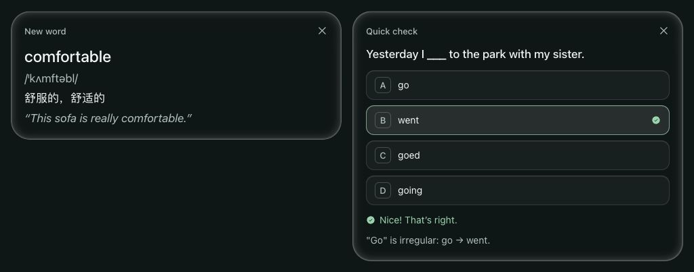
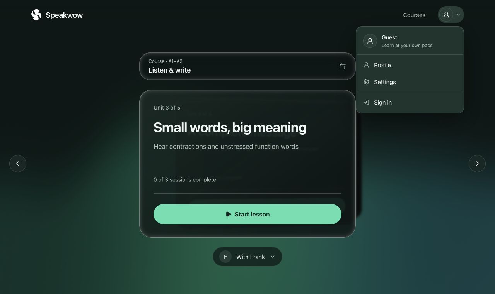
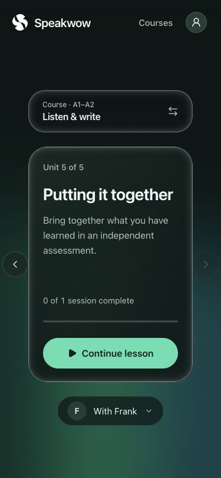
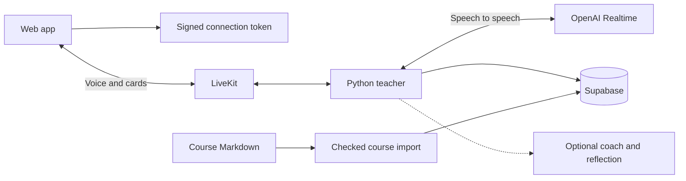
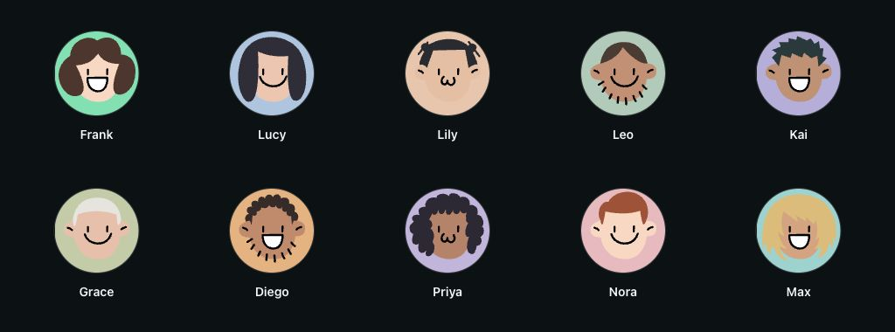

<div align="center">


# Speakwow

**A voice teacher who remembers you.**

Learn through real conversation, guided courses and small moments of discovery.
An open-source AI tutor with room for questions, tangents and a break.

[Try Speakwow](https://speakwow.ai) · [中文](README.zh-CN.md) · [Get started](#run-locally) · [Contribute](CONTRIBUTING.md)

[](https://github.com/Noxr3/Speakwow/actions/workflows/web.yml)
[](https://github.com/Noxr3/Speakwow/actions/workflows/agent.yml)
[](https://github.com/Noxr3/Speakwow/actions/workflows/supabase.yml)
[](LICENSE)

</div>

## A look inside

The running App: a focused lesson home, a browsable curriculum and an account menu that stays out of the way.

[](https://speakwow.ai)

<table>
<tr>
<td width="50%"></td>
<td width="50%"></td>
</tr>
<tr><td align="center">Courses</td><td align="center">Syllabus</td></tr>
</table>



<details>
<summary>User menu and mobile</summary>




</details>

[Media and capture notes](docs/media/README.md) · [Brand kit](docs/BRAND.md) · [Roadmap](docs/ROADMAP.md)

## The experience

Choose a course, pick up a unit, and talk with your teacher. Courses contain lessons,
practice, review and independent checks. Each enrollment keeps its own place. You
can also start with free conversation, explore another topic or take a break.

- **A conversation with a voice.** OpenAI Realtime is the default (`gpt-realtime-2.1`).
  Teachers hear speech directly; delivery instructions guide curiosity, encouragement,
  gentle correction and clear demonstrations. Frank uses `cedar`. Semantic turn
  detection gives learners more time to finish a thought.
- **Ten distinct teachers.** Different voices, accents, interests and teaching styles,
  with short introductions in the teacher menu. Their shared teaching rules stay consistent.
- **A course of your own.** A separate catalogue with categories and difficulty filters;
  lessons follow a syllabus while leaving room for conversation. Progress is saved from
  assessed work, rather than inferred from how long someone has talked.
- **Practice you can touch.** Word cards, quizzes, sentence building, picture prompts,
  dictation, writing and story games connect spoken practice with on-screen interaction.
- **Continuity between calls.** With Supabase configured, the teacher can use earlier
  summaries, learning goals and memories. Students review and edit these in **Profile**.
- **Your choice of key.** Use the operator's OpenAI key or bring an OpenAI/xAI key.
  Explicit personal provider choices are preserved; stored personal keys are encrypted.

The [course library](courses/README.md) includes eight language-skill series, Yilin
junior-high English outlines and a venture-fundraising course. Course review status is
recorded in its source; an outline is not a licensed copy of a textbook.
Phone and SMS are optional integrations that need their own configuration; see
[Phone and SMS](docs/PHONE_AND_SMS.md).

## Run locally

You need Node.js 22, pnpm 9, Python 3.10–3.13, [uv](https://docs.astral.sh/uv/),
a [LiveKit](https://livekit.io) project and an OpenAI API key with Realtime access.

```bash
git clone https://github.com/Noxr3/Speakwow.git
cd Speakwow
pnpm install --frozen-lockfile
cp apps/web/.env.example apps/web/.env.local
cp apps/agent/.env.example apps/agent/.env.local
```

Fill `LIVEKIT_URL`, `LIVEKIT_API_KEY` and `LIVEKIT_API_SECRET` in **both** env files.
Set `OPENAI_API_KEY` in the **agent's** env file. Credentials stay on the server.
To choose xAI explicitly, set `REALTIME_PROVIDER=xai` and `XAI_API_KEY` on the agent.

Start the teacher in one terminal, from the repository root:

```bash
cd apps/agent
uv sync --locked
uv run src/agent.py download-files
uv run src/agent.py dev
```

Start the web app in another terminal, from the repository root:

```bash
pnpm --filter @speakwow/web dev
```

Open [localhost:3000](http://localhost:3000). Without Supabase, guest conversation works;
accounts, persistent memories and enrolled course progress need the database.

### Add accounts and courses

Apply [`supabase/migrations`](supabase/migrations/) to your Supabase project. For a new
local database, use `supabase start` followed by `supabase db reset` from the repository
root. Reset is for disposable local data; existing installations should apply migrations.

Set the web's `NEXT_PUBLIC_SUPABASE_URL` / `NEXT_PUBLIC_SUPABASE_ANON_KEY`, and the
agent's `SUPABASE_URL` / `SUPABASE_SERVICE_ROLE_KEY`. To import the checked course files,
set `SUPABASE_URL` and `SUPABASE_SERVICE_ROLE_KEY` in the importing shell, then run:

```bash
pnpm courses:check
pnpm course:import --all --dry-run
pnpm course:import --all
```

Imports update by course slug and unit position. Keep published course, goal and session
IDs stable so students keep their place. See [course rules](courses/AGENTS.md).

## Configuration

Start from [web env](apps/web/.env.example) and [agent env](apps/agent/.env.example).
Optional integrations are off until configured.

| Configuration | Location | Purpose |
| --- | --- | --- |
| `LIVEKIT_URL`, `LIVEKIT_API_KEY`, `LIVEKIT_API_SECRET` | Web + agent | Same LiveKit project for media and dispatch |
| `OPENAI_API_KEY` | Agent | Default Realtime voice service |
| `REALTIME_PROVIDER`, `OPENAI_REALTIME_MODEL`, `XAI_REALTIME_MODEL` | Agent | Defaults: `openai`, `gpt-realtime-2.1`, `grok-voice-3.0` |
| `XAI_API_KEY`, `TURN_SILENCE_MS` | Agent | Optional xAI voice and silence-based turn detection |
| `NEXT_PUBLIC_SUPABASE_URL`, `NEXT_PUBLIC_SUPABASE_ANON_KEY` | Web | Accounts, Profile and enrolled courses |
| `SUPABASE_URL`, `SUPABASE_SERVICE_ROLE_KEY` | Agent | Server-side learning memory and progress |
| `AI_GATEWAY_API_KEY` | Agent | Optional coaching and post-call reflection |
| `MEMORY_LLM_API_KEY`, `MEMORY_LLM_BASE_URL`, `MEMORY_LLM_MODEL` | Agent | Alternative OpenAI-compatible reflection model |
| `COACH=off` | Agent | Disable background coaching |
| `BYOK_ENCRYPTION_KEY` | Web + agent | Same 32-byte base64 secret for personal keys (`openssl rand -base64 32`) |
| `REQUIRE_BYOK=true`, `ALLOW_GUESTS=false` | Web | Optional operator access policies |
| `NEXT_PUBLIC_SITE_URL` | Web | Public origin for social previews; default `https://speakwow.ai` |

Twilio, phone verification and SMS variables are documented in [Phone and SMS](docs/PHONE_AND_SMS.md).
For deployment, the web app builds from `apps/web`; the voice worker runs from `apps/agent`.
Configure both against the same LiveKit project. Database changes may require coordinated
web and agent releases. See the [web guide](apps/web/README.md) and [agent guide](apps/agent/README.md).

## Architecture



| Directory | Responsibility |
| --- | --- |
| [`apps/web`](apps/web/) | Next.js app, course selection, call UI, Profile and settings |
| [`apps/agent`](apps/agent/) | Realtime teacher, course workflow, assessment, memory and tools |
| [`packages/shared`](packages/shared/) | Persona cards, sticker data and shared contracts |
| [`courses`](courses/) | Versioned, reviewable curriculum outlines |
| [`supabase`](supabase/) | Database migrations and SQL checks |
| [`assets/brand`](assets/brand/) | Vector master and supplied logo reference |
| [`scripts`](scripts/) | Course imports, shared-data sync and brand exports |

LiveKit and Supabase can be self-hosted. The default speech model still requires an
external API; the application is not a fully offline tutor. Voice latency and expression
vary with the model, network and conversation.

## Development and documentation

Run checks from the repository root:

```bash
(cd apps/agent && uv run ruff check && uv run pytest -m 'not live')
pnpm --filter @speakwow/web lint
pnpm --filter @speakwow/web test
pnpm --filter @speakwow/web build
pnpm test:scripts
pnpm courses:check
```

- [Contributing](CONTRIBUTING.md): add teachers, courses and interactive cards.
- [Course architecture](docs/COURSE_SERIES.md) and [course design review](docs/COURSE_DESIGN_REVIEW.md).
- [Voice expression research](docs/VOICE_EXPRESSION_REVIEW.md): capabilities, tradeoffs and validation limits.
- [Brand assets](docs/BRAND.md): logos, dark/light use, icons and export commands.
- [UI design system](docs/UI_DESIGN_SYSTEM.md) and [roadmap](docs/ROADMAP.md).

Profile memory edits do not erase existing call transcripts or summaries. A running call
may retain the context it already loaded; see the [memory implementation notes](apps/web/README.md#learner-memory).

## License and attribution

[MIT](LICENSE), with third-party exceptions recorded alongside the assets:

- React Bits components include MIT + Commons Clause notices; retain each component's license.
- Animated stickers use Google's [Noto Animated Emoji](https://googlefonts.github.io/noto-emoji-animation/), CC BY 4.0.
- The web and agent apps began with LiveKit's MIT-licensed starter templates.

### Teacher artwork and loading performance



Teacher portraits use [DiceBear Dylan](https://www.dicebear.com/styles/dylan/),
a remix of Natalia Spivak's artwork under CC BY 4.0.
[Attribution and regeneration](apps/web/licenses/dylan.md) · [Loading architecture and measurements](docs/PERFORMANCE.md).
