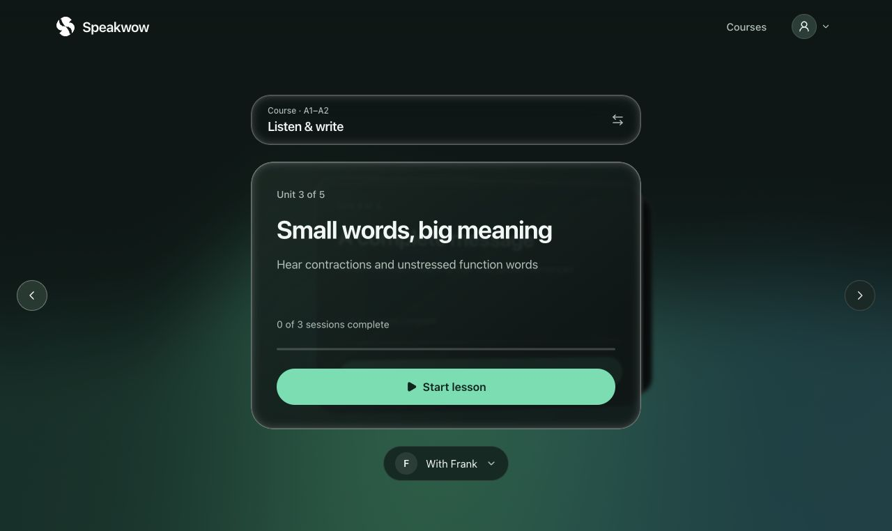
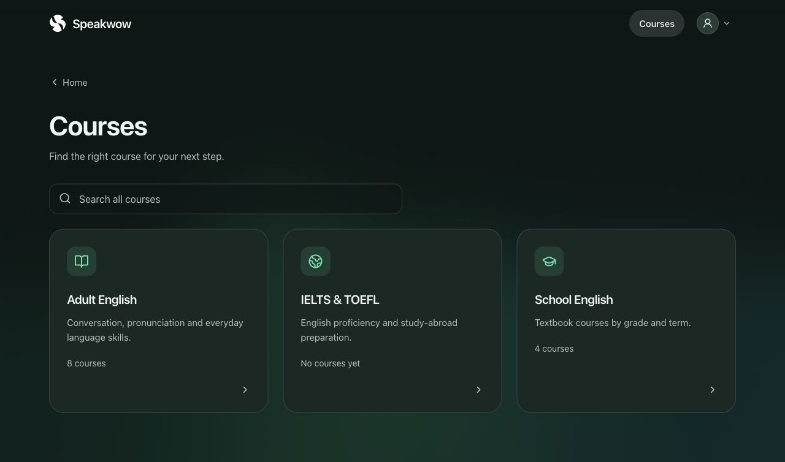
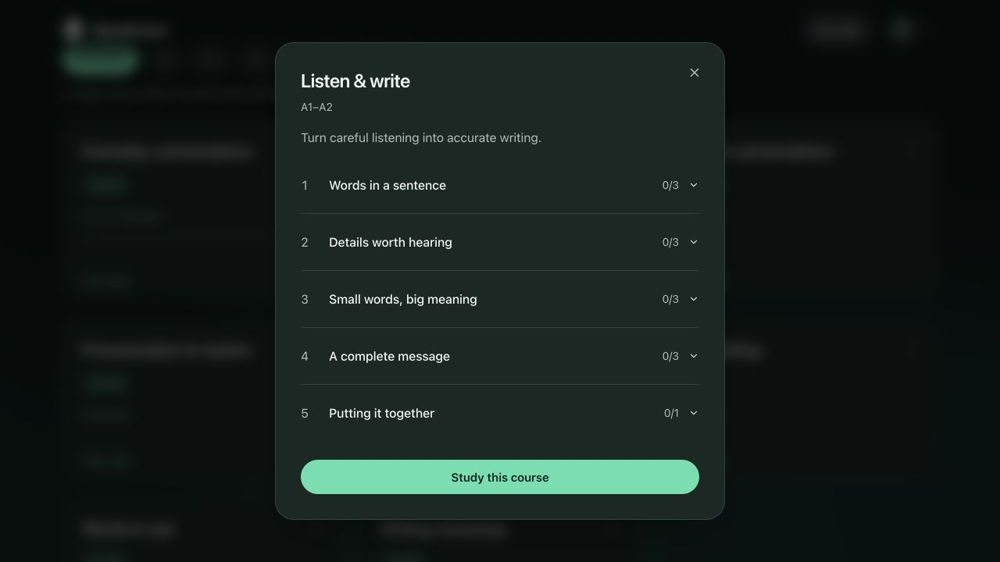
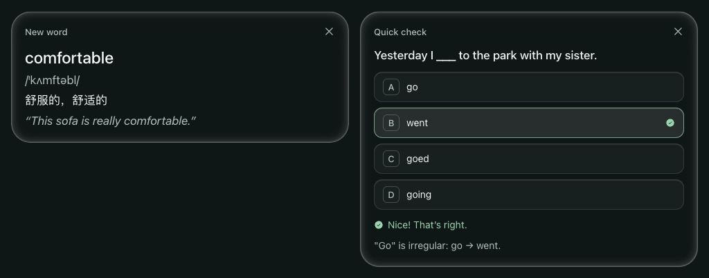
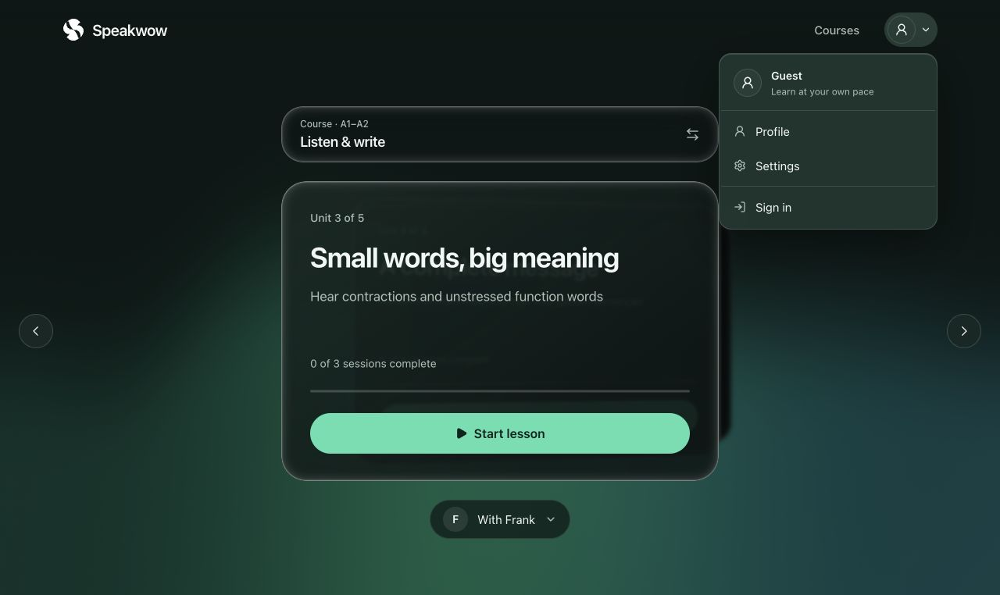
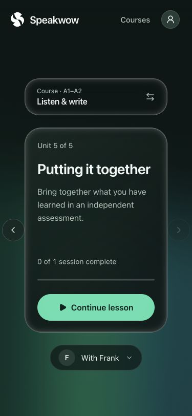

<div align="center">


# Speakwow

**一位记得你的语音老师。**

通过自然对话、循序渐进的课程和互动练习学习。
开源的 AI 家庭教师，也给提问、发散和休息留一点空间。

[开始体验](https://speakwow.ai) · [English](README.md) · [本地运行](#本地运行) · [参与贡献](CONTRIBUTING.md)

</div>

## 产品预览

真实 App 截图：聚焦当前课程与单元的首页、分层课程导航，以及统一的用户头像菜单。

[](https://speakwow.ai)

<table>
<tr>
<td width="50%"></td>
<td width="50%"></td>
</tr>
<tr><td align="center">Courses</td><td align="center">Syllabus</td></tr>
</table>



<details>
<summary>用户菜单与手机界面</summary>




</details>

[截图与素材说明](docs/media/README.md) · [品牌素材](docs/BRAND.md) · [路线图](docs/ROADMAP.md)

## 学习体验

选一门课，打开一个单元，与老师开始交流。课程包含讲解、练习、复习和独立检查，
每门已选课程分别保存进度。没有选课也可以自由聊天，上课中可以聊开一点，或暂停休息。

- **有语气的对话。** 默认使用 OpenAI Realtime（`gpt-realtime-2.1`），直接接收语音并生成语音。
  发声指令区分好奇、鼓励、温和纠错和示范；Frank 使用 `cedar`。语义判停为学习者留出思考时间。
- **十位不同的老师。** 不同音色、口音、兴趣和教学风格，选择菜单里附有简述，共用同一套教学规则。
- **自己的课程。** 独立选课页提供分类与难度筛选。教学围绕大纲展开，也允许自然发散。
  进度依据评估结果保存，不会仅因为聊了一段时间就视为完成。
- **能动手的练习。** 单词卡、选择题、连词成句、图片、听写、写作和故事小游戏连接语音与卡片互动。
- **通话之间的衔接。** 配置 Supabase 后，老师能读取过往总结、学习目标和记忆；学生可在 **Profile** 中查看和修改。
- **可选择的 API Key。** 使用运营方的 OpenAI key，或自带 OpenAI / xAI key。个人明确选择的供应商会被保留，保存的个人 key 会加密。

[课程库](courses/README.md)包含八种语言技能系列、译林版初中英语大纲和融资课程。
每份课程保留来源与审读状态；大纲并非教材原文。电话和短信属于需要另外配置的可选集成，
详见[接入说明](docs/PHONE_AND_SMS.md)。

## 本地运行

需要 Node.js 22、pnpm 9、Python 3.10–3.13、[uv](https://docs.astral.sh/uv/)、
一个 [LiveKit](https://livekit.io) 项目，以及可访问 Realtime 的 OpenAI API key。

```bash
git clone https://github.com/Noxr3/Speakwow.git
cd Speakwow
pnpm install --frozen-lockfile
cp apps/web/.env.example apps/web/.env.local
cp apps/agent/.env.example apps/agent/.env.local
```

在两个 env 文件中填入相同项目的 `LIVEKIT_URL`、`LIVEKIT_API_KEY`、`LIVEKIT_API_SECRET`。
只在 agent 的 env 文件中填 `OPENAI_API_KEY`。密钥保留在服务端。
使用 xAI 时，显式设置 agent 的 `REALTIME_PROVIDER=xai` 和 `XAI_API_KEY`。

从仓库根目录启动老师：

```bash
cd apps/agent
uv sync --locked
uv run src/agent.py download-files
uv run src/agent.py dev
```

另开一个终端，从仓库根目录启动网页：

```bash
pnpm --filter @speakwow/web dev
```

打开 [localhost:3000](http://localhost:3000)。不配置 Supabase 也能以访客身份聊天；
账号、长期记忆和课程进度需要数据库。

### 启用账号和课程

将 [`supabase/migrations`](supabase/migrations/) 应用到 Supabase 项目。
新建本地数据库可在仓库根目录运行 `supabase start` 和 `supabase db reset`；
reset 用于可丢弃的本地数据，已有安装应通过迁移升级。

配置 web 的 `NEXT_PUBLIC_SUPABASE_URL` / `NEXT_PUBLIC_SUPABASE_ANON_KEY`，以及
agent 的 `SUPABASE_URL` / `SUPABASE_SERVICE_ROLE_KEY`。在导入课程的终端中也设置后两项，然后运行：

```bash
pnpm courses:check
pnpm course:import --all --dry-run
pnpm course:import --all
```

导入按课程 slug 与单元位置原地更新。已发布的课程、目标和课节 ID 应保持稳定，避免破坏学生进度。
详见[课程维护规则](courses/AGENTS.md)。

## 配置与部署

完整变量表见英文 README 的 [Configuration](README.md#configuration)，示例文件位于
[web](apps/web/.env.example) 和 [agent](apps/agent/.env.example)。

- 默认实时语音为 OpenAI；可用 `OPENAI_REALTIME_MODEL` 覆盖模型。
- `AI_GATEWAY_API_KEY` 启用可选的后台教练与复盘；`COACH=off` 关闭后台教练。
- `BYOK_ENCRYPTION_KEY` 在 web 与 agent 两侧必须相同，使用 `openssl rand -base64 32` 生成。
- `REQUIRE_BYOK=true` 要求自带 key，`ALLOW_GUESTS=false` 限制为登录用户。
- 自托管时设置 web 的 `NEXT_PUBLIC_SITE_URL`，让分享卡片使用正确域名。

web 从 `apps/web` 构建，语音 worker 从 `apps/agent` 运行，两端连接同一 LiveKit 项目。
数据库变更可能需要协调发布，详见 [web 指南](apps/web/README.md)与 [agent 指南](apps/agent/README.md)。
LiveKit 和 Supabase 可自托管，但默认语音模型仍依赖外部 API，并非完全离线运行。
声音表现与延迟受模型、网络和对话内容影响。

## 开发与文档

在仓库根目录运行：

```bash
(cd apps/agent && uv run ruff check && uv run pytest -m 'not live')
pnpm --filter @speakwow/web lint
pnpm --filter @speakwow/web test
pnpm --filter @speakwow/web build
pnpm test:scripts
pnpm courses:check
```

| 文档 | 内容 |
| --- | --- |
| [参与贡献](CONTRIBUTING.md) | 新老师、新课程、互动卡片 |
| [课程架构](docs/COURSE_SERIES.md) | 系列、单元、课节与进度 |
| [课程设计研究](docs/COURSE_DESIGN_REVIEW.md) | 教学依据与验证范围 |
| [声音表现研究](docs/VOICE_EXPRESSION_REVIEW.md) | 官方、LiveKit、开源与社区实践 |
| [品牌使用](docs/BRAND.md) | 矢量 Logo、深浅色适配、图标与生成方法 |
| [UI 设计系统](docs/UI_DESIGN_SYSTEM.md) | 界面样式与交互 |
| [路线图](docs/ROADMAP.md) | 已有能力与后续工作 |

在 Profile 删除记忆不会同时删除历史通话文本或总结；进行中的通话可能已加载旧上下文。
详见[记忆实现说明](apps/web/README.md#learner-memory)。

## 许可证与致谢

项目采用 [MIT](LICENSE)，第三方资源按各自文件中的声明使用：React Bits 组件包含
MIT + Commons Clause 条款；Google [Noto Animated Emoji](https://googlefonts.github.io/noto-emoji-animation/)
采用 CC BY 4.0。web 与 agent 起步于 LiveKit 的 MIT 开源模板。
